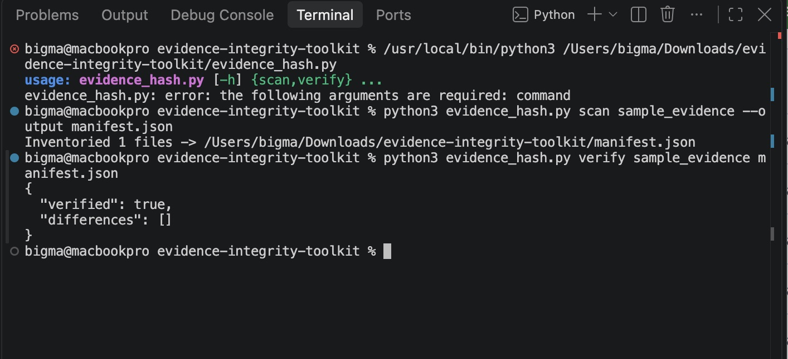
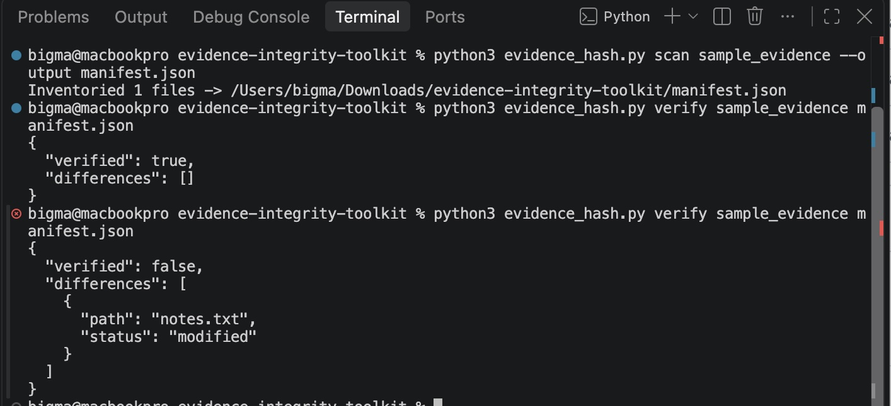

# Digital Forensics Portfolio Project

> Educational demonstration using **synthetic evidence only**. No real person's data is included. Results require analyst validation and should not be treated as proof of wrongdoing.

## Skills demonstrated
SHA-256 verification, immutable-source workflow, manifest comparison, JSON reports, Python testing.

## Run (Python 3.9+; standard library only)
```bash
python evidence_hash.py scan sample_evidence --output manifest.json
python evidence_hash.py verify sample_evidence manifest.json
python -m unittest discover -s tests -v
```

## Evidence handling
All example files are fictional. Preserve originals, verify hashes, document timestamps/time zones, and maintain a chain of custody before using any process in a real investigation.

## Limitations
File hashes demonstrate byte-level equality, **not** authenticity, acquisition quality, or a complete chain of custody. Symlinks are intentionally skipped.


## Forensic Investigation Results

### Case Overview
**Case ID:** DEMO-001

**Investigation Type:** Digital Evidence Integrity Verification and Tampering Detection

**Evidence:** Fictional training file (`notes.txt`)

**Tools Used:** Python 3, hashlib (SHA-256), Visual Studio Code, GitHub

### Objective
The objective of this investigation was to demonstrate how cryptographic hashing can establish a baseline for digital evidence integrity and identify subsequent modifications.

### Methodology
1. Created an initial inventory of the sample evidence using SHA-256 hashing.
2. Generated a JSON manifest containing the original evidence hash.
3. Verified the evidence against its original hash.
4. Modified the sample evidence file in a controlled testing environment.
5. Re-ran the verification process to determine whether the modification could be detected.

### Findings

**Test 1 — Original Evidence Verification**

- Verification result: `true`
- Differences detected: None
- Finding: The evidence matched its original SHA-256 hash.

**Test 2 — Evidence Tampering Detection**

- Verification result: `false`
- File identified: `notes.txt`
- Status: `modified`
- Finding: The forensic tool detected that the evidence had changed after the original hash was recorded.

### Conclusion
The investigation successfully demonstrated how SHA-256 hashing can be used to verify digital evidence integrity and detect subsequent file modifications.

The results highlight the importance of maintaining reliable evidence baselines and documenting changes during forensic examinations.

**Limitations:** This project uses synthetic evidence. Hash verification can detect changes relative to a trusted baseline but does not independently establish chain of custody or prove malicious intent.


## Investigation Screenshots

### Original Evidence Verification


### Evidence Tampering Detection

